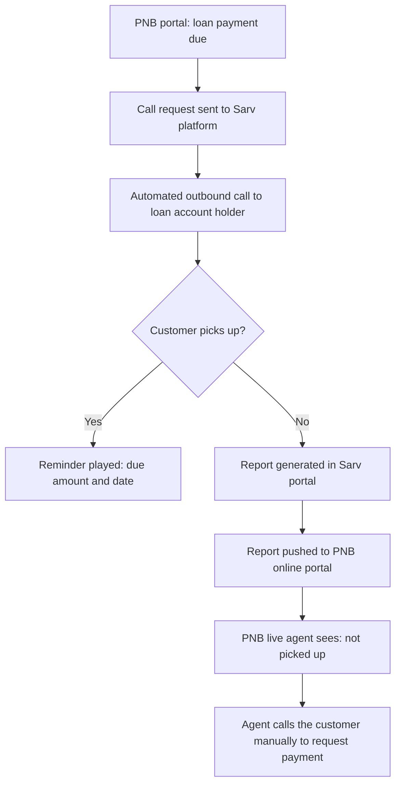
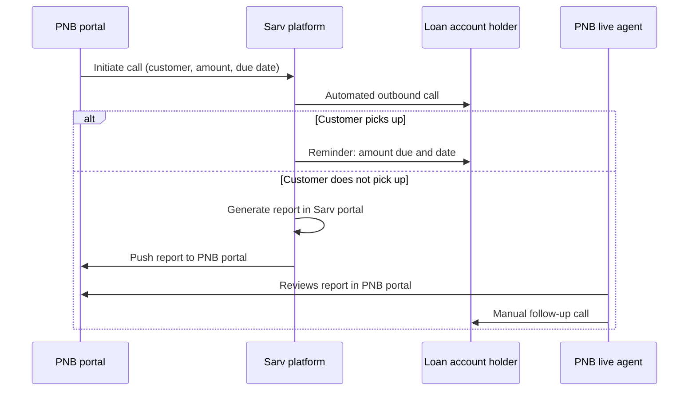

# Solution Architecture

## High-level flow

## Sequence

## Components
| Component | Owner | Role |
|---|---|---|
| PNB portal | PNB | Initiates call requests and shows reports to agents |
| Sarv platform | Sarv Group | Places automated calls and records the outcome |
| Sarv portal | Sarv Group | Holds the call report |
| Report push | Sarv Group + PNB | Sends the same report to the PNB portal |
| PNB live agents | PNB | Follow up manually with customers who did not pick up |

## Design notes
- **Portal-triggered:** calls start from the bank's own portal
- **Single report, two places:** the same information in the Sarv and PNB portals
- **Human follow-up where needed:** automation for the first touch, agents for the rest

## Diagram files
_Add the original draw.io / PNG architecture diagram here if one exists._
